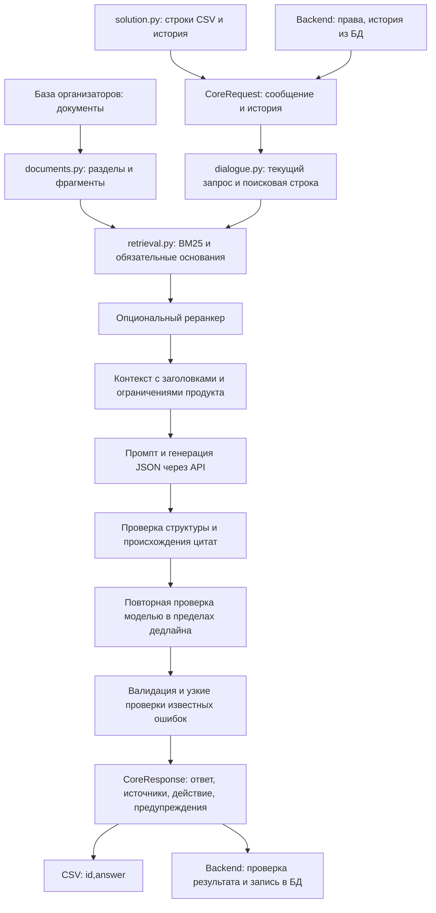

# Что умеет ядро 6v

Исходная версия и контрольная сумма закреплены в [индексе передачи](README.md).
Подробные подтверждения: [отчёт качества](../../core/QUALITY_6v_2026-11-14.md)
и [проверка сайта](../../core/SITE_REVIEW_6v_2026-11-14.md).

## Карта обработки

Ядро не создаёт заявки и не управляет аккаунтами. Оно предлагает ответ и черновик;
права, сохранение и явное согласие остаются у backend. Контракт —
[CORE_INTEGRATION.md](../CORE_INTEGRATION.md). Общая фабрика `consultant_core.create_core()`
и `respond(CoreRequest)` используются и API, и конкурсным CSV.

## Реализовано

| Участок | Поведение 6v | Ограничение |
|---|---|---|
| Документы | 19 исходных документов, в проверенной загрузке 477 фрагментов; заголовки, таблицы, устойчивые ID | Размер зависит от корпуса и настроек разбиения |
| История | Разбор обычных вопросов, размеченных диалогов и JSON-истории; текущая реплика отделена | Поисковая строка использует также предыдущие реплики и может усилить старую тему |
| Поиск | BM25, словарь/нормализация, отбор разделов и обязательных фрагментов | Нет dense-поиска и использования EMB_MODEL; отрицание продукта не учитывается корректно |
| Реранкер | Опциональный вызов при RERANKER_MODEL | Сохраняет обязательные источники, даже если их выбрали ошибочно |
| Генерация | Ответ по контексту, структурированный результат, согласование JSON-формата с API | Валидный JSON ещё не означает правильный смысл |
| Проверка | Цитаты связаны с фрагментами; повторная проверка моделью | Проверяющая модель может повторить ошибку генератора |
| Известные ошибки | Узкая защита от переноса бесплатности расчёта на обследование; условия проверки OCR; устранение части повторных вопросов и ошибок резюме | Это отдельные исправления, а не универсальная проверка каждого утверждения |
| CSV | Сохранение ID, параллельность, атомарная запись, отчёт о сбоях | Наличие всех строк не доказывает полезность ответов; нужен отдельный смысловой разбор |
| API | То же ядро, изолированная история, идемпотентность на стороне backend | Модель может выдавать разные корректные формулировки для одинакового входа |

Настройки по умолчанию: TOP_K=5, MAX_TOKENS=1200, MAX_WORKERS=4,
контекст источников 14 000 символов, история 16 000 символов, бюджет запроса
100 секунд. Это не полный токенный бюджет модели. Системный промпт, JSON-схема,
история, ответ и реранкер также расходуют контекст/время. Окружение может менять значения.

## Что действительно проверено

- Официальный ZIP скачан с сайта и сопоставлен с локальным релизом; балл — 49,861.
- В последнем реальном локальном прогоне 18 demo получены 18 ответов без технических
  сбоев за 213,219 секунды; дополнительная проверка одного ответа не завершилась.
  После него финальные изменения валидации проверялись воспроизведением сохранённых
  ответов и отдельными реальными вызовами, а не новым полным прогоном всех 18.
- Проверка 5 сценариев API/CSV подтвердила равенство входов/истории и идемпотентность.
- Локальное сравнение с собственным V8: 58,859, 5 побед / 2 поражения / 11 ничьих.
  Это не сравнение с V5 и не прогноз сайта.
- Восемь новых формулировок прошли локальные критерии первого разбора. Это малый
  набор; после просмотра и исправлений он не считается независимым.
- Использованная локально квантованная модель отличается от модели платформы.

## Что мешает качеству сейчас

1. Подтверждённый дефект поиска: «Солнечные панели не рассматриваем. Нужен только
   учёт электричества по арендаторам. С чего начать?» закрепляет также обязательный
   раздел для солнечной станции. Запрос про единый кабинет с отказом от солнечных
   станций и оптового рынка тоже загрязняет отбор. Это воспроизведение поиска,
   не доказательство ошибки в скрытых ответах площадки.
2. Следующий вопрос иногда не нужен или повторяет уже известные сведения:
   например, после ответа о двух тарифах или описанного обхода с фотографиями.
3. Проверка цитаты не устанавливает, что каждое обещание, число и условие следует
   из неё. Уже наблюдалось сохранение неверного обещания проверяющим проходом.
4. Новые формулировки «единый кабинет» могут слабо попадать в нужный продукт.
5. Локальные наборы многократно использовались для исправлений; нужен свежий закрытый
   от разработчика набор. Сайт не предоставил доступной построчной разметки или логов
   судьи: ссылки успешной отправки вернули исходный ZIP.

Нельзя вывести из этих сведений точное число будущих баллов или приписать каждому
дефекту долю потерь. В истории сайта 120,3 секунды подписаны как длительность
загрузки; это значение не используем как подтверждённую скорость генерации.
